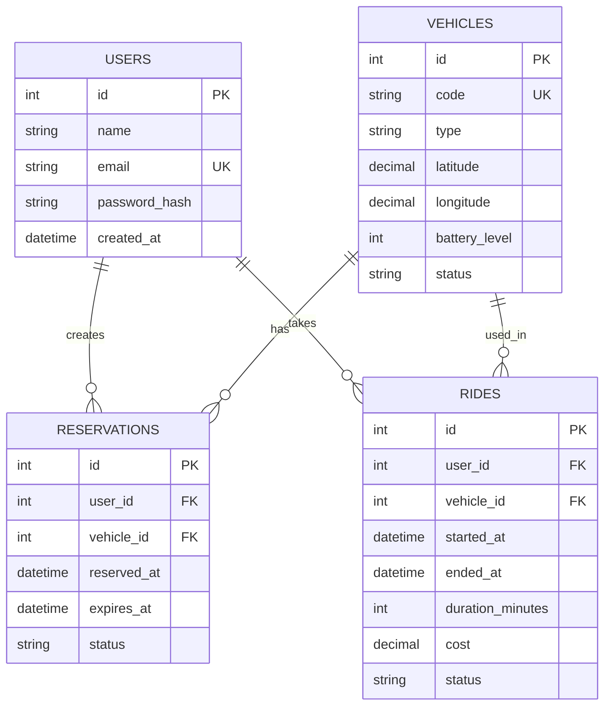

# TurboRower - Road Map projektu

## 1. Cel i zakres wersji v1

**Tytuł projektu:** TurboRower - system zarządzania siecią hulajnóg i rowerów
miejskich.

**Główny odbiorca:** osoba wypożyczająca miejski rower lub hulajnogę.

**Cel v1:** użytkownik może zalogować się, znaleźć dostępny pojazd,
zarezerwować go, rozpocząć i zakończyć przejazd oraz sprawdzić historię
przejazdów i naliczoną opłatę.

Wersja v1 koncentruje się na kompletnym, demonstracyjnym procesie wypożyczenia
pojazdu. System korzysta z danych zapisanych w aplikacji, bez wymagania
rzeczywistych modułów GPS/GSM, urządzeń IoT ani prawdziwego operatora
płatności. Dane pojazdów mogą być przygotowane jako dane testowe, a opłata
jest obliczana według ustalonej taryfy. Funkcje serwisowe, zaawansowany panel
operatora i geofencing zostają odłożone do kolejnych iteracji.

### Funkcje wybrane do v1

- **F01** - rejestracja i logowanie użytkownika,
- **F02** - wyświetlanie mapy i listy dostępnych pojazdów,
- **F03** - rezerwowanie i anulowanie własnej rezerwacji,
- **F04** - rozpoczęcie i zakończenie przejazdu,
- **F05** - historia przejazdów i naliczona opłata.

### Pomysły odłożone do kolejnej iteracji

- **F06** - zgłaszanie usterek pojazdów,
- **F07** - panel operatora do monitorowania floty,
- **F08** - definiowanie wirtualnych stref.

## 2. Cykl iteracji

Praca nad v1 przebiega w kolejności:

1. **Widoki** - ustalenie ekranów i przejść użytkownika.
2. **Struktura bazy** - określenie danych potrzebnych przez widoki.
3. **Funkcjonalności** - opisanie działania i warunków poprawności.
4. **Sprawdzenie spójności** - każda funkcja ma przypisany widok i dane.

Po ocenie v1 rozpocznie się iteracja v2, ponownie od analizy widoków.

## 3. Widoki aplikacji

### W01 - Logowanie i rejestracja

**Użytkownik:** osoba korzystająca z aplikacji.  
**Cel:** utworzenie konta lub zalogowanie się do systemu.

**Elementy widoku:**

- nagłówek „TurboRower”,
- pole adresu e-mail,
- pole hasła,
- przycisk „Zaloguj się”,
- przycisk lub odnośnik „Utwórz konto”.

**Dane wprowadzane:** e-mail i hasło; przy rejestracji także nazwa
użytkownika.  
**Dane wyświetlane:** komunikat o poprawnym logowaniu albo błąd walidacji.  
**Przejścia:** poprawne logowanie prowadzi do W02, a rejestracja otwiera
formularz rejestracji.

```text
+----------------------------------+
|           TURBOROWER             |
|                                  |
|  E-mail      [________________]  |
|  Hasło       [________________]  |
|                                  |
|          [ ZALOGUJ SIĘ ]         |
|          Utwórz konto             |
|  [komunikat błędu / powodzenia]  |
+----------------------------------+
```

### W02 - Mapa i lista pojazdów

**Użytkownik:** zalogowany użytkownik.  
**Cel:** znalezienie dostępnego pojazdu i przejście do jego rezerwacji.

Widok zawiera nagłówek, profil, mapę z oznaczeniami pojazdów, listę
dostępnych pojazdów, typ pojazdu, poziom baterii, przybliżoną lokalizację
oraz przycisk „Zarezerwuj”. Wyświetlane są dane z tabeli `vehicles`.

Wybranie „Zarezerwuj” tworzy rezerwację i otwiera W03. Wybranie historii
otwiera W04. Brak pojazdów powoduje wyświetlenie odpowiedniego komunikatu.

```text
+----------------------------------+
| TurboRower             [Profil]  |
|          MAPA POJAZDÓW           |
|       o       o        o         |
| Dostępne pojazdy:                |
| [Rower R-001]   82% [REZERWUJ]  |
| [Hulajnoga H-04] 64% [REZERWUJ] |
| [Mapa]             [Historia]    |
+----------------------------------+
```

### W03 - Szczegóły pojazdu i aktywna rezerwacja/przejazd

**Użytkownik:** zalogowany użytkownik z wybranym pojazdem.  
**Cel:** potwierdzenie rezerwacji, rozpoczęcie i zakończenie przejazdu.

Widok pokazuje identyfikator i typ pojazdu, poziom baterii, status, aktywną
rezerwację, czas trwania oraz opłatę. Zawiera przyciski „Rozpocznij przejazd”
i „Zakończ przejazd”. Start zmienia status pojazdu na `IN_USE`, a zakończenie
zapisuje przejazd i otwiera W04.

```text
+----------------------------------+
| < Wróć       Szczegóły pojazdu   |
|        HULAJNOGA H-04            |
|        Bateria: 64%               |
|        Status: ZAREZERWOWANA      |
|                                  |
|       [ ROZPOCZNIJ PRZEJAZD ]    |
|       [ ZAKOŃCZ PRZEJAZD ]       |
|  Czas: --:--       Opłata: -- zł |
+----------------------------------+
```

### W04 - Historia przejazdów

**Użytkownik:** zalogowany użytkownik.  
**Cel:** sprawdzenie zakończonych przejazdów i naliczonych opłat.

Widok zawiera listę przejazdów od najnowszego, typ i identyfikator pojazdu,
datę, czas trwania, opłatę oraz sumę opłat. Wyświetlane są wyłącznie
przejazdy zalogowanego użytkownika z tabeli `rides`. Przy pustej historii
wyświetlany jest odpowiedni komunikat.

```text
+----------------------------------+
| < Mapa       Moje przejazdy      |
|  04.11.2026  H-04   18 min       |
|              Opłata: 12,60 zł    |
|  02.11.2026  R-001  25 min       |
|              Opłata: 15,00 zł    |
|  Suma opłat: 27,60 zł             |
| [Mapa]             [Historia]    |
+----------------------------------+
```

## 4. Struktura bazy danych

| Tabela | Podstawowe pola |
|---|---|
| `users` | `id` (PK, liczba), `name` (tekst), `email` (tekst, unikalny), `password_hash` (tekst), `created_at` (data i godzina) |
| `vehicles` | `id` (PK, liczba), `code` (tekst, unikalny), `type` (tekst), `latitude` (liczba dziesiętna), `longitude` (liczba dziesiętna), `battery_level` (liczba), `status` (tekst) |
| `reservations` | `id` (PK, liczba), `user_id` (FK -> `users.id`), `vehicle_id` (FK -> `vehicles.id`), `reserved_at` (data i godzina), `expires_at` (data i godzina), `status` (tekst) |
| `rides` | `id` (PK, liczba), `user_id` (FK -> `users.id`), `vehicle_id` (FK -> `vehicles.id`), `started_at` (data i godzina), `ended_at` (data i godzina), `duration_minutes` (liczba), `cost` (liczba dziesiętna), `status` (tekst) |

### Reguły i relacje

- Jeden użytkownik może mieć wiele rezerwacji: `users 1:N reservations`.
- Jeden pojazd może występować w wielu rezerwacjach w różnym czasie:
  `vehicles 1:N reservations`.
- Jeden użytkownik może mieć wiele przejazdów: `users 1:N rides`.
- Jeden pojazd może występować w wielu przejazdach w różnym czasie:
  `vehicles 1:N rides`.
- Aktywna rezerwacja lub przejazd nie może kolidować z inną aktywną
  rezerwacją lub przejazdem tego samego pojazdu.
- `vehicles.status` przyjmuje wartości `AVAILABLE`, `RESERVED`, `IN_USE`
  i `UNAVAILABLE`.
- Hasło jest przechowywane jako `password_hash`, a nie jako tekst jawny.



## 5. Opis funkcjonalności v1

| ID | Użytkownik i działanie | Widok | Dane | Warunek poprawności i błąd |
|---|---|---|---|---|
| F01 | Użytkownik rejestruje konto lub loguje się e-mailem i hasłem. | W01 | `users` | Poprawne dane tworzą sesję i otwierają W02. Błędne hasło lub zajęty e-mail powoduje komunikat i brak sesji. |
| F02 | Użytkownik przegląda dostępne pojazdy na mapie i liście. | W02 | `vehicles` | Wyświetlane są tylko pojazdy dostępne. Brak danych pokazuje komunikat. |
| F03 | Użytkownik wybiera dostępny pojazd i tworzy lub anuluje własną rezerwację. | W02, W03 | `users`, `vehicles`, `reservations` | Rezerwacja blokuje pojazd. Jeśli pojazd został wcześniej zajęty, operacja jest odrzucona i status odświeżony. |
| F04 | Użytkownik rozpoczyna, a następnie kończy przejazd zarezerwowanym pojazdem. | W03 | `users`, `vehicles`, `reservations`, `rides` | Start tworzy aktywny przejazd, a zakończenie zapisuje czas, długość i koszt. Bez aktywnej rezerwacji operacja jest odrzucona. |
| F05 | Użytkownik przegląda własną historię przejazdów i opłat. | W04 | `users`, `rides` | Lista zawiera wyłącznie przejazdy zalogowanego użytkownika. Przy pustej historii pojawia się komunikat. |

## 6. Mapa prac dla v1

| Zadanie | Odpowiedzialność | Termin | Zależność | Oczekiwany rezultat |
|---|---|---:|---|---|
| Potwierdzenie celu i zakresu v1 | Damian i Adrian | 2026-11-04 | Labo 01 | Zakres F01-F05 i lista funkcji odłożonych |
| Przygotowanie szkiców W01-W04 i nawigacji | Damian | 2026-11-06 | Cel i zakres v1 | Szkice widoków, dane i przejścia |
| Opracowanie tabel, kluczy i relacji | Adrian | 2026-11-06 | Widoki | Tabela danych i schemat ER |
| Spisanie działania F01-F05 | Damian i Adrian | 2026-11-08 | Widoki i baza | Warunki poprawności i obsługa błędów |
| Sprawdzenie spójności mapy | Damian i Adrian | 2026-11-09 | Powyższe zadania | Każda funkcja ma widok i dane |
| Uzupełnienie LaboChat i linków | Adrian | 2026-11-10 | Roadmapa v1 | Zadania i link do dokumentacji |
| Weryfikacja README i commitów | Damian | 2026-11-10 | Roadmapa v1 | README zawiera link, obie osoby mają commit |

## 7. Kierunek iteracji v2

### V2-01 - Zgłaszanie usterek

Użytkownik będzie mógł zgłosić problem z poziomu W03. Pojawi się przycisk
„Zgłoś usterkę” i formularz typu usterki. Do bazy zostanie dodana tabela
`fault_reports` z polami `id`, `user_id`, `vehicle_id`, `type`, `description`,
`status` i `created_at`. Dojdzie funkcja F06 oraz komunikat potwierdzający
zapis zgłoszenia.

### V2-02 - Panel operatora

Operator otrzyma osobny widok z listą pojazdów, filtrowaniem po statusie
i poziomie baterii oraz podglądem zgłoszeń. Zostaną dodane uprawnienia
użytkownika i ewentualna tabela `service_orders`. Rozszerzona zostanie F07,
ale podstawowe widoki użytkownika nie będą wymagały zmiany.

### V2-03 - Wirtualne strefy

Operator będzie mógł definiować obszary z ograniczeniami. Pojawi się widok
mapy stref i tabela `zones` z geometrią lub współrzędnymi oraz regułami.
Funkcja F08 będzie sprawdzać możliwość rozpoczęcia lub zakończenia przejazdu
w danym obszarze.

## 8. Kontrola kompletności

- [x] Określono cel i zakres v1.
- [x] Wybrano 5 funkcji MVP.
- [x] Opisano 4 widoki i przejścia między nimi.
- [x] Przygotowano szkice widoków.
- [x] Zdefiniowano tabele, pola, klucze i relacje.
- [x] Każda funkcja F01-F05 ma przypisany widok i dane.
- [x] Przygotowano mapę zadań z odpowiedzialnością, terminami i zależnościami.
- [x] Zapisano 3 pomysły na v2 oraz ich wpływ.
- [ ] Uzupełnić zadania i link do roadmapy w LaboChat.com.
- [ ] Wykonać merytoryczny commit każdej osoby.

